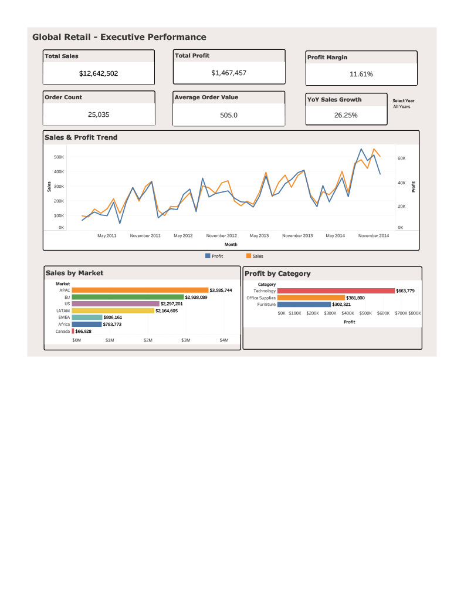
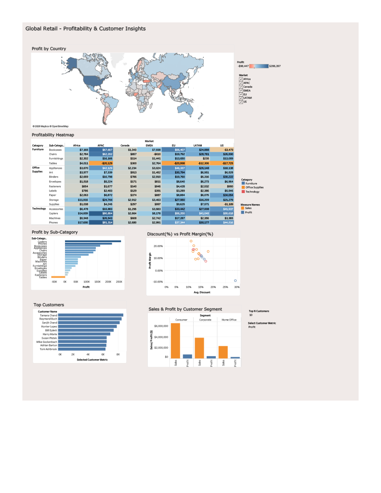

# Global Retail: Performance, Profitability & Business Insights

## Project overview
An end-to-end retail analytics project using Tableau to evaluate global sales performance, profitability, product performance and customer value. The project translates transactional data into two interactive dashboards and a Tableau Story designed to support business decision-making.

[**Explore the interactive Tableau dashboards and story**](https://public.tableau.com/app/profile/ololade.osinubi/viz/GlobalSuperstore_17939070655670/GlobalRetailPerformanceProfitabilityBusinessInsights)

## Business objectives
- Evaluate revenue growth and overall profitability.
- Identify high-performing and loss-making markets and product groups.
- Explore the relationship between discounting and profit margins.
- Assess customer value and performance across customer segments.
- Develop actionable recommendations based on the findings.

## Dataset
The Global Superstore sample dataset contains approximately 51,000 retail transaction records spanning 2011–2014, covering seven markets and three product categories. Fields include order dates, customer segments, geography, product categories, sales, profit and discounts.

## Tools and analytical techniques
- Tableau Public (web authoring)
- Calculated fields and aggregated KPIs
- Parameters, interactive filters and dynamic customer rankings
- Year-over-year growth using table calculations
- Geographic maps, heatmaps, dual-axis charts and scatter plots
- Dashboard design and data storytelling

## Executive performance

| KPI | All-years result (rounded) |
| --- | ---: |
| Total sales | $12.64M |
| Total profit | $1.47M |
| Profit margin | 11.61% |
| Distinct orders | 25,035 |
| Average order value | $505 |
| Sales growth, 2011–2014 | 90.3% |

Profit margin is calculated as total profit divided by total sales; average order value is total sales divided by distinct order count. Cumulative sales growth compares 2014 with 2011.

This dashboard provides an executive-level view of sales and profit trends, market performance and category profitability, with a year selection control.

## Profitability and customer insights

This dashboard explores geographic profitability, market and product-level performance, discounting versus margins, top customers and customer segment performance. Dynamic customer ranking controls allow users to switch between sales and profit and select the number of customers displayed.

## Key findings and recommendations

| Finding | Business recommendation |
| --- | --- |
| Annual sales rose from approximately $2.26M in 2011 to $4.30M in 2014. | Examine the markets and products driving growth to guide investment. |
| APAC was the largest market by sales. | Prioritize market opportunities while evaluating profitability alongside revenue. |
| Tables generated losses in four of seven markets, with a combined net loss of approximately $64K across all markets. | Investigate pricing, discount policies and costs for this sub-category. |
| The discount-versus-margin analysis reveals a high-discount, negative-margin outlier. | Review discount thresholds and test their relationship with profitability at a more granular level. |

## Limitations
This analysis uses historical sample data rather than live business records. Aggregate relationships between discounts and margins do not establish causation. Recommendations should be validated with more detailed cost, pricing and operational information before implementation.

## Repository contents
- [Data](data/) — source dataset
- [Tableau](tableau/) — Tableau workbook
- [Dashboards](dashboards/) — dashboard previews

## Interactive project
[View the complete Tableau Story on Tableau Public](https://public.tableau.com/app/profile/ololade.osinubi/viz/GlobalSuperstore_17939070655670/GlobalRetailPerformanceProfitabilityBusinessInsights)
